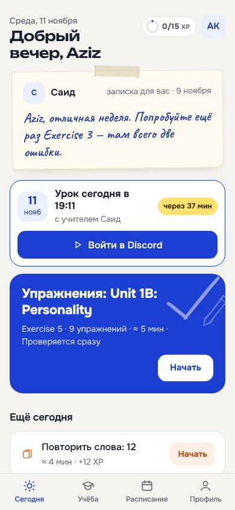
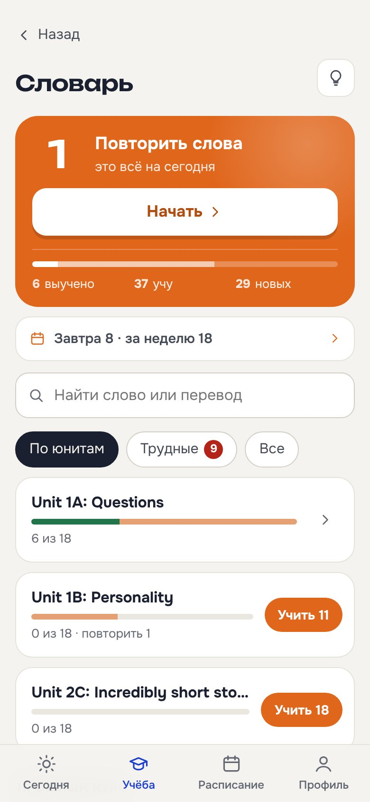
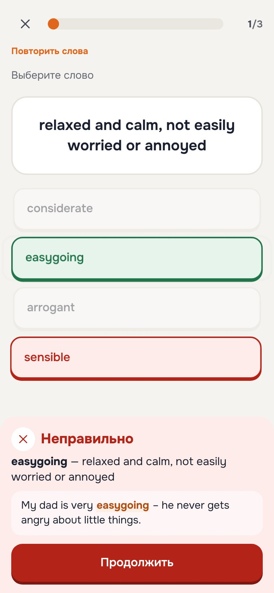
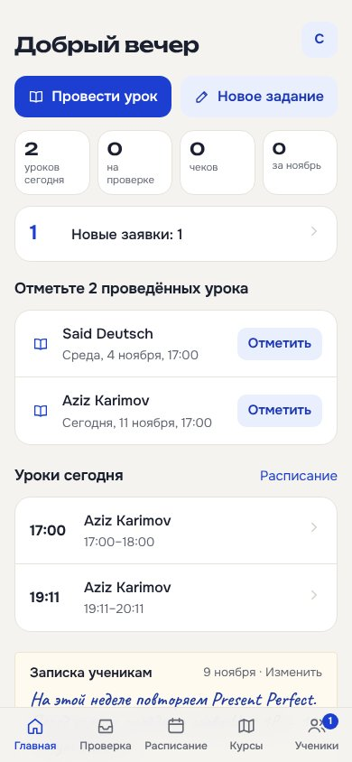
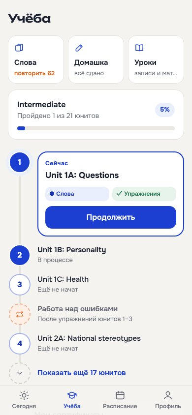
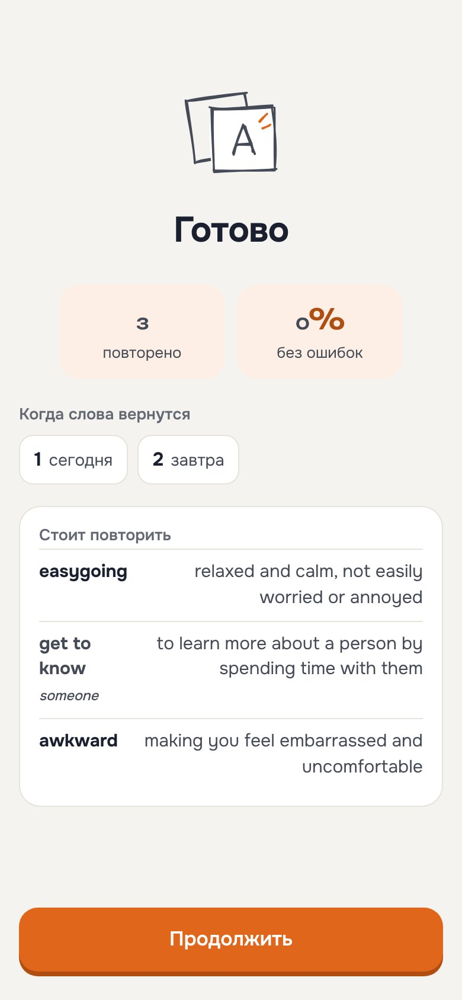

# Fluentry

**A Telegram Mini App, bot and website for an English school** — designed, built and run by me, in production with real students.

[fluentry.uz](https://fluentry.uz) · Telegram Mini App · in production since 2026

  
  
  
  

**The problem.** In a small school, homework lived in chat threads, new words were forgotten within a week, and lessons, payments and progress were tracked by hand. **The product** puts all of it where students already are — Telegram — and automates the routine for the teacher.

I did the whole thing: product decisions, the data model, backend, frontend, the website, deployment and support.

> The source code is private because it contains licensed course material. This repository is the public overview — happy to walk through the code in an interview.

## What it does

**For students**
- **Today screen** — the next lesson with a countdown and a "Join" button, today's homework, a daily goal and a streak
- **Courses** — units with exercises: multiple choice, gap fill, word order, matching, reading, IELTS Listening with audio
- **Dictionary with spaced repetition** — words arrive after each lesson; reviews on day 1, 3, 7, 14, 30, then every 90 days; a daily limit so a backlog never piles up; a "do I already know these?" check
- **Homework** — text, photo and voice answers; voice is transcribed to text for the teacher
- **Schedule** — book, move or cancel a lesson within the teacher's free hours
- **Progress** — certificates, a mock IELTS band, a monthly report to forward to parents

**For the teacher**
- A dashboard: lessons today, work to review, receipts, money received this month, site traffic
- Lessons log themselves: when a lesson ends the bot asks "how did it go?" with one-tap answers, and logs it automatically if nobody answers
- Payments by lesson or by month, receipt review, balance reminders
- Course import from plain text, so a whole book unit is added in a minute

**The website** — [fluentry.uz](https://fluentry.uz): prerendered React, 97–100 in Lighthouse, live free slots from the schedule, sign-up straight into the bot.

## How it's built

| | |
|---|---|
| Backend | Python · FastAPI · aiogram 3 · SQLAlchemy 2 (async) · Alembic |
| Frontend | React 18 · TypeScript · Vite · TanStack Query · GSAP (site) |
| Data | PostgreSQL in production, SQLite locally · 25 migrations |
| Infrastructure | Docker Compose · Caddy (HTTPS, compression) · one VPS · nightly backups sent to Telegram |
| Integrations | Telegram Bot API and Mini Apps (signed `initData` checked on the server) · Whisper speech-to-text |
| Quality | 133 async API tests (pytest) · Lighthouse for the site |

About 15k lines of Python, 19k lines of TypeScript, 4.5k lines of tests.

### A few decisions I'm happy with

- **One codebase, three surfaces.** The bot, the Mini App and the site share one FastAPI service and one database. The site is prerendered at build time and hydrated; the Mini App loads only when opened from Telegram.
- **Spaced repetition by study day, not by hour.** A word is due from 04:00 of its day, so someone who studies in the evening sees it again the next evening — not 23 hours later. Reviews are ordered by how overdue they are relative to their interval.
- **Automation that never surprises.** Auto-logged lessons skip anything the teacher already touched, never fire at night, and never reach back to lessons from before the feature was switched on.
- **Updates never touch student progress.** Every schema change is an additive migration; tests cover moving a student between courses with hundreds of words.

  
  

---

Built by [Said](https://github.com/sourtadope) · Tashkent · Telegram [@sourtadope](https://t.me/sourtadope)
